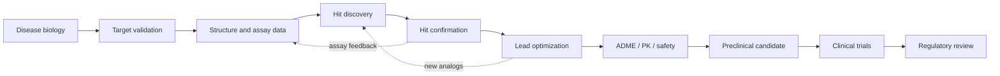

# AI for Protein Structure Prediction and Drug Discovery

A GitHub-renderable research knowledge base connecting AI-based protein structure prediction to the broader drug-discovery lifecycle: target biology, structural modeling, virtual screening, molecular design, bioactivity prediction, ADMET, validation, and clinical translation.

> **Scientific principle:** a predicted structure is a model; a predicted binder is a hypothesis; an experimentally confirmed hit is a result in a particular assay; a drug requires a much larger body of preclinical, clinical, manufacturing, and regulatory evidence.

## Documentation map

| # | Chapter | What you will learn |
|---:|---|---|
| 01 | [Overview](docs/01-overview.md) | Protein folding, structure concepts and confidence metrics |
| 02 | [Major AI Systems](docs/02-major-ai-systems.md) | AlphaFold, ESMFold, RoseTTAFold and co-folding systems |
| 03 | [Companies and Ecosystem](docs/03-companies-ecosystem.md) | Research organizations and the industry landscape |
| 04 | [Choosing a Tool](docs/04-choosing-a-tool.md) | Match a tool to the research question |
| 05 | [Limitations and Interpretation](docs/05-limitations-and-interpretation.md) | Confidence, dynamics, disorder and failure modes |
| 06 | [Applications](docs/06-applications.md) | Structural biology and translational applications |
| 07 | [AI Drug Discovery Pipelines](docs/07-ai-drug-discovery-pipelines.md) | AI across discovery and development |
| 08 | [Disease Case Studies](docs/08-disease-case-studies.md) | Selected disease-area examples |
| 09 | [End-to-End AI Drug Discovery](docs/09-end-to-end-ai-drug-discovery.md) | Lifecycle, design–make–test–learn and evidence gates |
| 10 | [Datasets and Data Engineering](docs/10-datasets-and-data-engineering.md) | Protein, chemistry, bioactivity, ADMET and benchmark data |
| 11 | [Models and Methods](docs/11-models-and-methods.md) | Representations, model families and evaluation metrics |
| 12 | [Getting Started Project](docs/12-getting-started-project.md) | Reproducible bioactivity prediction starter project |
| 13 | [Benchmarks and Reproducibility](docs/13-benchmarks-reproducibility.md) | Leakage, split design, uncertainty and reporting |
| 14 | [Reading List and Resources](docs/14-reading-list-and-resources.md) | Papers, datasets, software, regulatory and institutional resources |
| 15 | [Citation and Claim Audit](docs/15-citation-and-claim-audit.md) | How to assess source quality and maintain the knowledge base |

## Learning paths

- **New to the field:** 01 → 02 → 05 → 09
- **Build a first ML project:** 10 → 11 → 12 → 13
- **Structure-based discovery:** 02 → 04 → 05 → 09 → 11
- **Generative chemistry:** 10 → 11 → 13 → 14
- **Translational research:** 07 → 08 → 09 → 14
- **Research paper preparation:** 10 → 13 → 14 → 15

## Drug discovery workflow

## Citation and evidence policy

- Prefer peer-reviewed primary papers, official databases, regulatory sources, and versioned repositories.
- Cite scientific claims inline with DOI or canonical links. Add access dates for mutable pages and “as of” dates for company or clinical pipeline claims.
- Separate peer-reviewed findings, preprints, company-reported results, retrospective benchmarks, and prospective experimental evidence.
- Record data/model version, license, provenance, evaluation split, and limitations.
- Do not treat a predicted structure, docking score, generated molecule, or retrospective metric as proof of biological activity or clinical efficacy.

**Maintenance note:** chapters 01–08 are the original overview material and include legacy citation markers and time-sensitive company/disease claims that need source-by-source verification before being used as a research citation. Chapters 09–15 add a more reproducible framework with explicit primary-source links; see [Citation and Claim Audit](docs/15-citation-and-claim-audit.md). This is a research learning resource, not medical advice or a substitute for institutional safety, ethics, or regulatory review.

## Contributing

Corrections and additions should include a canonical source, publication year, license where relevant, and a concise explanation of why the source supports the claim. Keep tables readable on GitHub, use Mermaid for diagrams, avoid unsupported numerical rankings, and document when facts were last checked.
