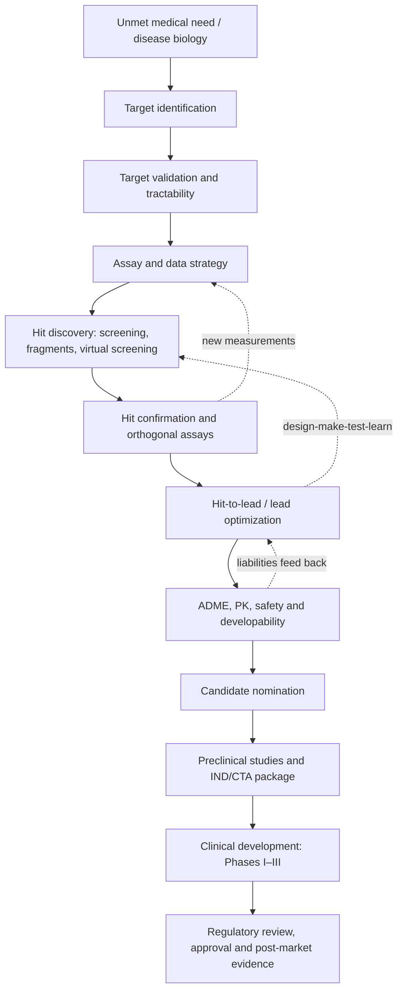
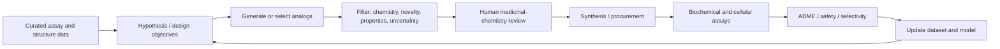

# 09 — End-to-End AI-Enabled Drug Discovery

[Back to README](../README.md) · [Datasets](10-datasets-and-data-engineering.md) · [Models](11-models-and-methods.md) · [Hands-on project](12-getting-started-project.md)

This chapter connects protein structure prediction with the larger process of discovering and developing medicines. It is a research map, not a clinical or medicinal-chemistry protocol.

## 1. The complete lifecycle

AI can contribute at many points, but no single model replaces the chain of biological, chemical, toxicological, manufacturing, and clinical evidence. See the review of early AI-discovered clinical candidates by [Jayatunga et al. (2024)](https://doi.org/10.1016/j.drudis.2024.104009); its Phase I estimates were based on a limited and evolving cohort, and should not be read as proof that AI broadly improves clinical success.

## 2. Target identification and validation

A target may be a protein, nucleic acid, pathway component, or biological process. A useful target is not simply associated with disease: perturbing it should plausibly improve disease outcomes, and the intervention should have a manageable safety window.

**Evidence to assemble:** human genetics and disease association; expression and tissue context; loss-/gain-of-function perturbation; pharmacological evidence; pathway biology; patient stratification; known ligands and liabilities. Use [Open Targets](https://platform.opentargets.org/), [UniProt](https://www.uniprot.org/), [Human Protein Atlas](https://www.proteinatlas.org/), and primary literature as complementary sources, not as interchangeable truth labels.

**AI opportunities:** knowledge-graph prioritization, omics integration, perturbation prediction, literature mining, single-cell analysis, and target tractability prediction. Avoid target selection based only on a language-model summary or a correlation in a high-dimensional dataset.

## 3. Structural biology and target tractability

A predicted structure can help formulate hypotheses about active sites, interfaces, allostery, and possible ligand pockets. Start with an experimental structure from the [Protein Data Bank (PDB)](https://www.rcsb.org/) when a suitable construct, ligand state, and conformation are available. Consult the [AlphaFold Protein Structure Database](https://alphafold.ebi.ac.uk/) for predictions; the database's 2024 paper reported more than 214 million predicted structures, but coverage does not imply equal confidence or ligand-ready accuracy ([Varadi et al., 2024](https://doi.org/10.1093/nar/gkad1011)).

For complexes, [AlphaFold 3](https://doi.org/10.1038/s41586-024-07487-w) predicts joint structures of many biomolecular components. Treat a predicted pose as a hypothesis. Check local geometry, pocket plausibility, protonation/tautomer assumptions, cofactors, waters, metal coordination, alternate conformations, and whether the target state matches the biological question.

## 4. Hit discovery approaches

| Approach | What it does | Typical strengths | Important failure modes |
|---|---|---|---|
| Experimental high-throughput screening | Measures large compound libraries in an assay | Direct experimental signal | Assay artifacts, library bias, cost |
| Structure-based virtual screening | Ranks compounds against a target structure | Scales computationally; interpretable pose hypotheses | Scoring errors, wrong receptor state, docking bias |
| Ligand-based screening | Uses known active/inactive molecules | Useful when target structures are weak or absent | Activity cliffs, chemical-series bias |
| Fragment-based discovery | Finds small, weak binders for growth | Efficient exploration of binding interactions | Requires sensitive assays and expert growth strategy |
| Generative design | Proposes molecules to optimize a multi-objective score | Explores chemical space and analogs | Reward hacking, novelty without synthesizability, model uncertainty |
| DNA-encoded / display / biophysical discovery | Enriches binders experimentally | Can reveal unexpected chemotypes | Selection bias and translation to functional potency |

A virtual-screening hit is not a confirmed hit. Confirm identity and purity, reproduce activity, use counterscreens, and seek orthogonal binding or functional evidence. Docking scores should not be presented as binding free energies unless the method and calibration support that interpretation.

## 5. Lead optimization: design–make–test–learn

Optimization is multi-objective. Common dimensions include potency, selectivity, solubility, permeability, metabolic stability, clearance, exposure, toxicity, synthetic accessibility, and patentability. A single weighted score can hide trade-offs; report Pareto fronts, constraints, and uncertainty. Keep a record of proposed, synthesized, tested, failed, and deprioritized compounds to reduce survivorship bias.

## 6. ADME, PK, safety, and developability

ADME describes absorption, distribution, metabolism, and excretion; PK describes concentration over time. In silico models can prioritize experiments but are endpoint- and domain-dependent. A molecule that passes a predicted toxicity filter is not thereby safe. In vitro, in vivo, mechanistic, and clinical evidence have different scopes and must be interpreted accordingly.

Useful datasets and tools include [TDC](https://tdcommons.ai/), [ChEMBL](https://www.ebi.ac.uk/chembl/), [PubChem](https://pubchem.ncbi.nlm.nih.gov/), [ADMETlab](https://admetlab3.scbdd.com/), and [SwissADME](http://www.swissadme.ch/). Review endpoint definitions, units, species, assay protocols, censoring, and data provenance before combining records.

## 7. Clinical translation and evidence claims

Clinical development asks questions that molecular benchmarks cannot answer: dose and exposure, safety, patient heterogeneity, clinically meaningful benefit, comparator performance, and reproducibility across sites. Phase transitions are not guaranteed, and a model-generated candidate may still fail because of biology, pharmacology, toxicity, formulation, trial design, or commercial feasibility.

When reporting an AI-enabled program, distinguish:

- **AI-assisted**: AI contributed to one or more workflow stages.
- **AI-designed / AI-discovered**: a company or paper attributes a material discovery step to AI; define the attribution.
- **Preclinical candidate**: nominated for further development, not proven safe or effective.
- **Clinical-stage**: entered human testing, not evidence of efficacy.
- **Approved medicine**: approved by a named regulator for a defined indication and label.

Prefer trial registries, regulator announcements, peer-reviewed papers, and company filings for pipeline status. Add an “as of” date to all time-sensitive claims.

## 8. What to measure at each stage

| Stage | Example evaluation | What it does not establish |
|---|---|---|
| Target | Perturbation replication; causal evidence; tissue relevance | Drugability or therapeutic window |
| Structure | Local/global accuracy; interface metrics; experimental agreement | Binding affinity or functional effect |
| Virtual screen | Enrichment factor, ROC-AUC/PR-AUC, prospective hit rate | Clinical usefulness |
| Generative chemistry | Validity, uniqueness, diversity, novelty, synthesizability | Experimental activity |
| Property model | External-set error, calibration, applicability domain | Safety outside training domain |
| Lead series | Potency/selectivity, ADME, exposure, repeatability | Human benefit |
| Clinical program | Prespecified efficacy and safety endpoints | Generalization beyond studied population |

## Selected references

1. Abramson et al. (2024), “Accurate structure prediction of biomolecular interactions with AlphaFold 3,” *Nature*. https://doi.org/10.1038/s41586-024-07487-w
2. Varadi et al. (2024), “AlphaFold Protein Structure Database in 2024,” *Nucleic Acids Research*. https://doi.org/10.1093/nar/gkad1011
3. Jayatunga et al. (2024), “How successful are AI-discovered drugs in clinical trials? A first analysis and emerging lessons,” *Drug Discovery Today*. https://doi.org/10.1016/j.drudis.2024.104009
